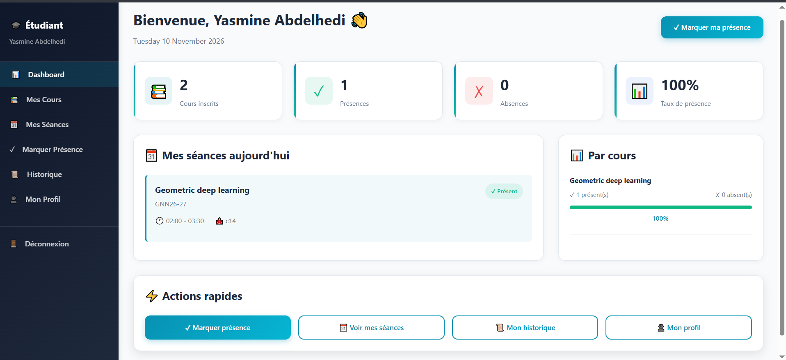

# Presence Management System

A web-based attendance management system with **facial recognition**, developed for the École Nationale d'Électronique et des Télécommunications de Sfax (ENET'Com).

Students check in to a live session with their webcam. The system compares their face with a reference photo, records their attendance with a confidence score, and marks absentees automatically once the session ends.


> The user interface and source code identifiers are in French.



---

## Table of Contents

- [Features](#features)
- [How It Works](#how-it-works)
- [Tech Stack](#tech-stack)
- [Architecture](#architecture)
- [Project Structure](#project-structure)
- [Getting Started](#getting-started)
- [Configuration](#configuration)
- [Usage](#usage)
- [Business Rules](#business-rules)
- [Database](#database)
- [Security](#security)
- [Maintenance Scripts](#maintenance-scripts)
- [Troubleshooting](#troubleshooting)
- [Documentation](#documentation)
- [Roadmap](#roadmap)
- [Author](#author)

---

## Features

### Student

- Personal dashboard with today's sessions and attendance statistics
- Reference photo upload (drag and drop, JPEG/PNG, 5 MB max) with face-embedding extraction
- **Webcam check-in** with real-time facial verification
- List of enrolled courses and sessions
- Attendance history with monthly filter and per-course statistics

### Teacher

- Dashboard with active courses, today's sessions and attendance rate
- Course creation (name, code, level, specialty, academic year) with **automatic student enrollment**
- Session scheduling (date, start and end time, room, type: *cours*, TD, TP, *examen*)
- Monthly agenda of scheduled sessions
- Per-session attendance sheets with manual status correction
- Export of attendance sheets to **Excel** and **PDF**

### Administrator

- Analytics dashboard with seven charts: attendance breakdown, session status, top courses, user distribution, 7-day attendance trend, validation methods and attendance rate per course
- User management: creation and deletion of students, teachers and administrators
- Global view of courses, sessions and attendance records, with filters
- Absence alerts, most assiduous students, and students without a reference photo
- Excel and PDF exports

---

## How It Works

```
 Teacher creates a course ──► matching students (level + specialty + year) are enrolled
            │
            ▼
 Teacher schedules a session            status: planifie
            │
            ▼  start time reached
 Session goes live                      status: en_cours
            │
            ├──► Student opens "Marquer présence" and captures a webcam frame
            │        │
            │        ▼
            │    api/marquer_presence.php          saves the capture to uploads/temp/
            │        │
            │        ▼
            │    python/face_recognition_verify.py  DeepFace · Facenet · cosine distance
            │        │  returns { match, confidence, distance }
            │        ▼
            │    match and confidence ≥ 70 %  ──► attendance recorded
            │                                      (present · method: image · score)
            ▼  end time passed
 Session closes                         status: terminee
            │
            ▼
 Enrolled students without a record are marked absent   (method: automatique)
```

Enrollment works in both directions: creating a course enrolls the matching students who already exist, and a newly registered student is enrolled in the matching active courses.

Session statuses and absences are updated by `SeanceDAO::updateStatutsAutomatique()` and `SeanceDAO::marquerAbsentsAutomatique()`. These run when the teacher dashboard or a course's session pages are loaded (at most once per minute, see `config/auto_update_seances.php`), and can also be scheduled with `cron/update_seances_statuts.php`.

---

## Tech Stack

| Layer            | Technology                                                                 |
| ---------------- | -------------------------------------------------------------------------- |
| Backend          | PHP 7.4+ (PDO, sessions, `password_hash`)                                  |
| Database         | MySQL 8 or MariaDB 10.4+ (`utf8mb4`)                                       |
| Face recognition | Python 3.10, [DeepFace](https://github.com/serengil/deepface) (Facenet model, OpenCV detector) |
| Frontend         | HTML5, CSS3, vanilla JavaScript, `getUserMedia` webcam API                 |
| Charts and icons | Chart.js 4.4, Font Awesome 6.4                                             |

Tested with PHP 8.3, MariaDB 10.11 (XAMPP 8.3), Python 3.10, DeepFace 0.0.104 and TensorFlow 2.21 on Windows 10.

---

## Architecture

The application follows a layered **MVC + DAO** design:

| Layer       | Folder         | Responsibility                                                                 |
| ----------- | -------------- | ------------------------------------------------------------------------------ |
| Models      | `models/`      | Domain entities (`User`, `Etudiant`, `Enseignant`, `Cours`, `Seance`, `Presence`) and their validation |
| DAO         | `dao/`         | Data access through PDO prepared statements                                    |
| Controllers | `controllers/` | Business logic, authorization and orchestration                                |
| Views       | `views/`       | Role-specific pages (`admin/`, `enseignant/`, `etudiant/`)                     |
| API         | `api/`         | JSON endpoint for face-based check-in                                          |
| ML scripts  | `python/`      | Face embedding extraction and verification, called from PHP                    |

`Etudiant` and `Enseignant` extend `User`. Each view restricts access by role with `AuthController::requireUserType()`.

---

## Project Structure

```
presence-management-system/
├── api/
│   └── marquer_presence.php          # Webcam capture → face verification → attendance
├── assets/css/                       # Shared stylesheet
├── config/
│   ├── database.php                  # PDO connection (reads .env)
│   ├── env.php                       # .env loader
│   └── auto_update_seances.php       # Throttled session status and absence updater
├── controllers/                      # Admin, Auth, Cours, Enseignant, Etudiant, Image, Presence, Seance
├── cron/
│   └── update_seances_statuts.php    # Scheduled version of the updater
├── dao/                              # Data access objects, one per entity
├── database/
│   └── schema.sql                    # Database schema
├── docs/                             # Setup guide and project notes (French)
├── models/                           # Domain entities
├── python/
│   ├── extract_face_encoding.py      # Facenet embedding of a reference photo
│   ├── face_recognition_verify.py    # Reference photo vs. webcam capture
│   └── requirements.txt
├── scripts/                          # Command-line maintenance scripts
├── uploads/
│   ├── images_reference/             # Student reference photos
│   └── temp/                         # Temporary webcam captures
├── views/
│   ├── admin/
│   ├── enseignant/
│   ├── etudiant/
│   └── index.php · login.php · register.php · logout.php
└── .env.example                      # Environment variables template
```

---

## Getting Started

### Prerequisites

- [XAMPP](https://www.apachefriends.org/) or any PHP 7.4+ and MySQL/MariaDB stack, with the `pdo_mysql`, `gd` and `fileinfo` extensions
- Python 3.10
- A browser with webcam access (the app must be served from `localhost` or over HTTPS)
- About 2 GB of disk space for the Python dependencies (TensorFlow)

### 1. Clone the repository

```bash
git clone https://github.com/abdelhedy/presence-management-system.git
cd presence-management-system
```

### 2. Configure the environment

```bash
copy .env.example .env          # Linux/macOS: cp .env.example .env
```

Then edit `.env` (see [Configuration](#configuration)). Without a `.env` file, the XAMPP defaults are used (user `root`, no password).

### 3. Create the database

Start MySQL, then import the schema. It creates the `systeme_presence` database and all its tables:

```bash
mysql -u root -p < database/schema.sql
```

The schema can also be imported from phpMyAdmin (**Import** tab).

### 4. Install the Python dependencies

```bash
python -m venv .venv
.venv\Scripts\python.exe -m pip install -r python/requirements.txt     # Linux/macOS: .venv/bin/python
```

PHP uses the project's `.venv` automatically. DeepFace downloads its model weights on first use, so the first verification is slower.

### 5. Create the administrator account

Set `ADMIN_EMAIL` and `ADMIN_PASSWORD` (8 characters minimum) in `.env`, then run:

```bash
php scripts/insert_admin.php
```

### 6. Run the application

**Option A: PHP built-in server** (quickest, the project can be anywhere on disk)

```bash
php -S localhost:8000
```

Then open http://localhost:8000/views/index.php

**Option B: Apache (XAMPP)**

Place the project in `htdocs` (or link it there), start Apache, then open http://localhost/presence-management-system/views/index.php

> Make sure the web server can write to `uploads/images_reference/` and `uploads/temp/`.

---

## Configuration

Environment variables (`.env`):

| Variable         | Description                                         | Default                            |
| ---------------- | --------------------------------------------------- | ---------------------------------- |
| `APP_URL`        | Base URL of the application                         | `http://localhost/presence-management-system` |
| `APP_DEBUG`      | Show detailed database errors (development only)    | `false`                            |
| `DB_HOST`        | Database host                                       | `localhost`                        |
| `DB_NAME`        | Database name                                       | `systeme_presence`                 |
| `DB_USER`        | Database user                                       | `root`                             |
| `DB_PASSWORD`    | Database password                                   | *(empty)*                          |
| `ADMIN_EMAIL`    | Initial administrator email                         | `admin@presence.com`               |
| `ADMIN_PASSWORD` | Initial administrator password                      | *(required, 8 characters minimum)* |
| `PYTHON_BIN`     | Python interpreter used for face recognition        | project `.venv`, otherwise `python` / `python3` |

Application settings:

| Setting                               | Location                             | Default                    |
| ------------------------------------- | ------------------------------------ | -------------------------- |
| Minimum confidence to accept a face   | `api/marquer_presence.php`           | 70 %                       |
| Face model, detector and metric       | `python/face_recognition_verify.py`  | Facenet · OpenCV · cosine  |
| Reference photo size and formats      | `controllers/ImageController.php`    | 5 MB · JPEG, PNG           |
| Status update interval                | `config/auto_update_seances.php`     | 60 s                       |
| Upload limits                         | `php.ini` (`upload_max_filesize`, `post_max_size`) | 10M recommended |

Confidence is computed as `(1 − cosine distance) × 100`. A capture is accepted only if it also passes DeepFace's own verification threshold.

---

## Usage

1. **Sign up.** Students and teachers create their account from the registration page: students select their specialty, level and academic year; teachers their department and grade. Administrators can also create accounts.
2. **Create a course.** The teacher creates a course; students with the same level, specialty and academic year are enrolled automatically.
3. **Schedule a session.** The teacher picks the course, date, time slot, room and session type.
4. **Add a reference photo.** The student uploads a clear, front-facing photo from **Mon Profil**.
5. **Check in.** During the session, the student opens **Marquer Présence**, selects the live session and captures their face. Attendance is recorded with the recognition score.
6. **Review.** After the session, absentees are recorded automatically. The teacher can review the sheet, correct statuses and export it to Excel or PDF.

---

## Business Rules

- A session's end time must be after its start time. Past dates and times cannot be selected when scheduling.
- Check-in is only possible while the session is `en_cours`, between its start and end times.
- Check-in requires a reference photo on file, and the capture must contain a detectable face.
- Webcam captures are deleted immediately after verification.
- When a session ends, every enrolled student without a record is marked `absent` with the method `automatique`.

See [`docs/CONTRAINTES_SYSTEME.md`](docs/CONTRAINTES_SYSTEME.md) for details.

---

## Database

Database: **`systeme_presence`**, defined in [`database/schema.sql`](database/schema.sql).

| Table              | Purpose                                                    | Key columns |
| ------------------ | ---------------------------------------------------------- | ----------- |
| `utilisateurs`     | All accounts                                               | `email`, `mot_de_passe` (hashed), `type_utilisateur` (`etudiant` / `enseignant` / `administrateur`) |
| `etudiants`        | Student profiles                                           | `numero_etudiant`, `niveau`, `specialite`, `annee_scolaire` |
| `enseignants`      | Teacher profiles                                           | `departement`, `grade` |
| `cours`            | Courses                                                    | `code_cours`, `id_enseignant`, `niveau`, `specialite`, `annee_scolaire`, `statut` (`actif` / `archive`) |
| `inscriptions`     | Student enrollments                                        | `id_cours`, `id_etudiant`, `statut` (`inscrit` / `desinscrit`) |
| `seances`          | Scheduled sessions                                         | `date_seance`, `heure_debut`, `heure_fin`, `type_seance`, `statut` (`planifie` / `en_cours` / `terminee` / `annule`) |
| `presences`        | Attendance records                                         | `statut` (`present` / `absent` / `retard` / `justifie`), `methode_validation` (`image` / `manuel` / `automatique`), `score_reconnaissance` |
| `images_reference` | Reference photos and face embeddings                       | `chemin_image`, `encodage_facial` |

Foreign keys use `ON DELETE CASCADE`: deleting a user removes their profile, enrollments and attendance records.

---

## Security

- Passwords are hashed with `password_hash()` (bcrypt).
- All database queries use PDO prepared statements.
- Credentials and secrets are stored in `.env`, which is excluded from version control.
- Database errors are logged; users only see a generic message unless `APP_DEBUG=true`.
- Each page checks the user's role before rendering.
- Maintenance scripts can only be run from the command line.
- Face recognition runs locally: no image is sent to a third-party service.

---

## Maintenance Scripts

Located in `scripts/` and run from the command line (`php scripts/<script>.php`). They change data directly, so back up the database first.

| Script                                     | Purpose                                                           |
| ------------------------------------------ | ----------------------------------------------------------------- |
| `insert_admin.php`                         | Create the initial administrator account                          |
| `check_statut.php`                         | Print the status of every session                                 |
| `fix_statuts.php`                          | Fix sessions with an empty status, then record absentees          |
| `add_statut_constraint.php`                | Back-fill missing statuses and enforce the `seances.statut` values |
| `fix_absences.php` / `update_absences.php` | Set the validation method of existing absences to `automatique`   |
| `enable_events.php` / `test_events.php`    | Enable and test optional MySQL scheduled events                   |

### Scheduled updates (optional)

To keep session statuses up to date independently of page visits, run the updater every few minutes:

```bash
# Linux (crontab)
*/5 * * * * php /path/to/presence-management-system/cron/update_seances_statuts.php
```

On Windows, create a Task Scheduler job that runs `php cron\update_seances_statuts.php` from the project folder.

---

## Troubleshooting

| Problem                                   | Solution                                                                      |
| ----------------------------------------- | ----------------------------------------------------------------------------- |
| "Service momentanément indisponible"      | The database connection failed: check `.env`, or set `APP_DEBUG=true` to see the error |
| "Module deepface non installé"            | Install the dependencies into `.venv`, or into the interpreter set in `PYTHON_BIN` |
| Verification always fails                 | Run the Python script manually with the same interpreter to see the error     |
| "Aucun visage détecté"                    | Use a well-lit, front-facing photo with a single face                         |
| Webcam blocked                            | Serve the app from `localhost` or over HTTPS, and allow camera access         |
| Upload fails                              | Check write permissions on `uploads/` and the `php.ini` upload limits         |
| Session statuses do not change            | Open the teacher dashboard, or schedule `cron/update_seances_statuts.php`     |
| A student is not enrolled in a course     | The student's level, specialty and academic year must exactly match the course's |

Logs: PHP and Apache errors are written to the web server's error log (`apache/logs/error.log` with XAMPP).

---

## Documentation

Additional documentation (in French) is available in [`docs/`](docs/):

- [`GUIDE_DEMARRAGE.md`](docs/GUIDE_DEMARRAGE.md): step-by-step setup guide and end-to-end test scenario
- [`CONTRAINTES_SYSTEME.md`](docs/CONTRAINTES_SYSTEME.md): system constraints and business rules
- [`python/README.md`](python/README.md): face recognition scripts

---

## Roadmap

- [ ] Liveness detection (anti-spoofing) for webcam check-in
- [ ] Email notifications for absence alerts
- [ ] Pagination and advanced search on administration lists
- [ ] Docker-based deployment

---

## Author

**Yasmine Abdelhedi** · [@abdelhedy](https://github.com/abdelhedy)

Academic project, ENET'Com Sfax, 2025.
